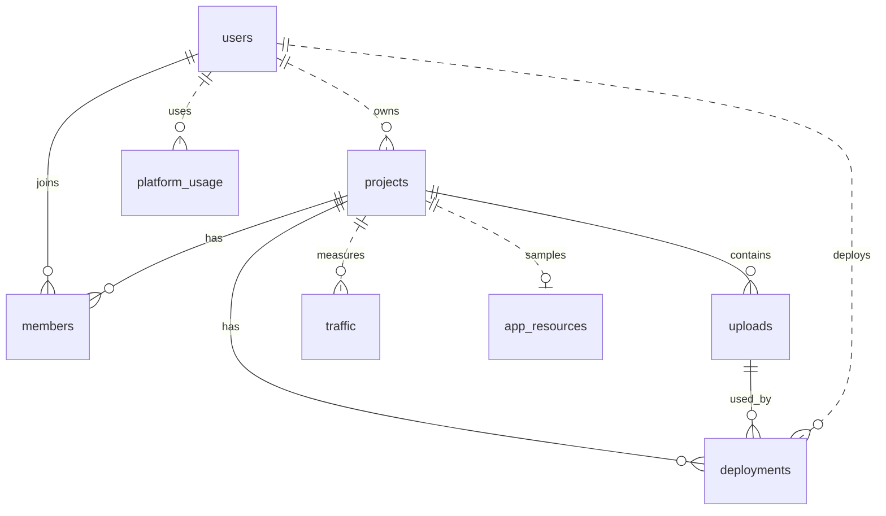

# Data model

Generated from application initialization on an empty temporary SQLite database. No production rows are exported. SQLite WAL mode; each application connection enables foreign keys. Timestamps are Unix seconds. JSON and encrypted values use TEXT columns.

## ER overview

Solid relationships below are declared foreign keys; dotted ones are application-level references, not SQL constraints.



`projects.active_release` logically references `deployments.id`. `owner_email`, upload/deployment emails, token identities and telemetry dimensions are not declared SQL foreign keys. Anonymous traffic stores an empty email. Multiple PK fields below form one composite primary key.

## app_resources

| Column | SQLite type | PK position | NOT NULL | Default |
|---|---|---|---|---|
| project | TEXT | 1 | False | — |
| updated | INTEGER | 0 | False | — |
| cpu | REAL | 0 | False | — |
| memory | INTEGER | 0 | False | — |
| memory_limit | INTEGER | 0 | False | — |
| state | TEXT | 0 | False | — |

```sql
CREATE TABLE app_resources(project TEXT PRIMARY KEY,updated INTEGER,cpu REAL,memory INTEGER,memory_limit INTEGER,state TEXT);
```

## audit

| Column | SQLite type | PK position | NOT NULL | Default |
|---|---|---|---|---|
| id | INTEGER | 1 | False | — |
| email | TEXT | 0 | True | — |
| action | TEXT | 0 | True | — |
| target | TEXT | 0 | True | — |
| created | INTEGER | 0 | True | — |

```sql
CREATE TABLE audit(id INTEGER PRIMARY KEY AUTOINCREMENT, email TEXT NOT NULL, action TEXT NOT NULL, target TEXT NOT NULL, created INTEGER NOT NULL);
```

## clients

| Column | SQLite type | PK position | NOT NULL | Default |
|---|---|---|---|---|
| id | TEXT | 1 | False | — |
| name | TEXT | 0 | True | — |
| redirects | TEXT | 0 | True | — |
| created | INTEGER | 0 | True | — |

```sql
CREATE TABLE clients(id TEXT PRIMARY KEY, name TEXT NOT NULL, redirects TEXT NOT NULL, created INTEGER NOT NULL);
```

## deployments

| Column | SQLite type | PK position | NOT NULL | Default |
|---|---|---|---|---|
| id | TEXT | 1 | False | — |
| project | TEXT | 0 | False | — |
| upload | TEXT | 0 | False | — |
| email | TEXT | 0 | True | — |
| status | TEXT | 0 | True | — |
| idem | TEXT | 0 | True | — |
| container | TEXT | 0 | False | — |
| error | TEXT | 0 | False | — |
| created | INTEGER | 0 | True | — |
| updated | INTEGER | 0 | True | — |
| env_snapshot | TEXT | 0 | False | — |

```sql
CREATE TABLE deployments(id TEXT PRIMARY KEY, project TEXT REFERENCES projects(id), upload TEXT REFERENCES uploads(id), email TEXT NOT NULL, status TEXT NOT NULL, idem TEXT NOT NULL, container TEXT, error TEXT, created INTEGER NOT NULL, updated INTEGER NOT NULL, env_snapshot TEXT, UNIQUE(project,email,idem));
```

## flows

| Column | SQLite type | PK position | NOT NULL | Default |
|---|---|---|---|---|
| id | TEXT | 1 | False | — |
| kind | TEXT | 0 | True | — |
| payload | TEXT | 0 | True | — |
| expires | INTEGER | 0 | True | — |

```sql
CREATE TABLE flows(id TEXT PRIMARY KEY, kind TEXT NOT NULL, payload TEXT NOT NULL, expires INTEGER NOT NULL);
```

## limits

| Column | SQLite type | PK position | NOT NULL | Default |
|---|---|---|---|---|
| key | TEXT | 1 | False | — |
| n | INTEGER | 0 | True | — |
| expires | INTEGER | 0 | True | — |

```sql
CREATE TABLE limits(key TEXT PRIMARY KEY, n INTEGER NOT NULL, expires INTEGER NOT NULL);
```

## members

| Column | SQLite type | PK position | NOT NULL | Default |
|---|---|---|---|---|
| project | TEXT | 1 | False | — |
| email | TEXT | 2 | False | — |
| role | TEXT | 0 | True | — |

```sql
CREATE TABLE members(project TEXT REFERENCES projects(id), email TEXT REFERENCES users(email), role TEXT NOT NULL, PRIMARY KEY(project,email));
```

## platform_usage

| Column | SQLite type | PK position | NOT NULL | Default |
|---|---|---|---|---|
| hour | INTEGER | 1 | False | — |
| email | TEXT | 2 | False | — |
| channel | TEXT | 3 | False | — |
| calls | INTEGER | 0 | False | 0 |

```sql
CREATE TABLE platform_usage(hour INTEGER,email TEXT,channel TEXT,calls INTEGER DEFAULT 0,PRIMARY KEY(hour,email,channel));
```

## projects

| Column | SQLite type | PK position | NOT NULL | Default |
|---|---|---|---|---|
| id | TEXT | 1 | False | — |
| name | TEXT | 0 | True | — |
| runtime | TEXT | 0 | True | — |
| visibility | TEXT | 0 | True | 'private' |
| active_release | TEXT | 0 | False | — |
| env | TEXT | 0 | False | — |
| created | INTEGER | 0 | True | — |
| owner_email | TEXT | 0 | False | — |

```sql
CREATE TABLE projects(id TEXT PRIMARY KEY, name TEXT NOT NULL, runtime TEXT NOT NULL, visibility TEXT NOT NULL DEFAULT 'private', active_release TEXT, env TEXT, created INTEGER NOT NULL, owner_email TEXT);
```

## telemetry_meta

| Column | SQLite type | PK position | NOT NULL | Default |
|---|---|---|---|---|
| key | TEXT | 1 | False | — |
| value | INTEGER | 0 | False | — |

```sql
CREATE TABLE telemetry_meta(key TEXT PRIMARY KEY,value INTEGER);
```

## tokens

| Column | SQLite type | PK position | NOT NULL | Default |
|---|---|---|---|---|
| hash | TEXT | 1 | False | — |
| kind | TEXT | 0 | True | — |
| email | TEXT | 0 | True | — |
| client | TEXT | 0 | True | '' |
| scope | TEXT | 0 | True | '' |
| resource | TEXT | 0 | True | '' |
| project | TEXT | 0 | False | — |
| expires | INTEGER | 0 | True | — |

```sql
CREATE TABLE tokens(hash TEXT PRIMARY KEY, kind TEXT NOT NULL, email TEXT NOT NULL, client TEXT NOT NULL DEFAULT '', scope TEXT NOT NULL DEFAULT '', resource TEXT NOT NULL DEFAULT '', project TEXT, expires INTEGER NOT NULL);
```

## traffic

| Column | SQLite type | PK position | NOT NULL | Default |
|---|---|---|---|---|
| hour | INTEGER | 1 | False | — |
| project | TEXT | 2 | False | — |
| email | TEXT | 3 | False | — |
| requests | INTEGER | 0 | False | 0 |
| bytes | INTEGER | 0 | False | 0 |
| errors4 | INTEGER | 0 | False | 0 |
| errors5 | INTEGER | 0 | False | 0 |
| duration_ms | REAL | 0 | False | 0 |

```sql
CREATE TABLE traffic(hour INTEGER,project TEXT,email TEXT,requests INTEGER DEFAULT 0,bytes INTEGER DEFAULT 0,errors4 INTEGER DEFAULT 0,errors5 INTEGER DEFAULT 0,duration_ms REAL DEFAULT 0,PRIMARY KEY(hour,project,email));
```

## traffic_cursor

| Column | SQLite type | PK position | NOT NULL | Default |
|---|---|---|---|---|
| container | TEXT | 1 | False | — |
| updated | INTEGER | 0 | False | — |

```sql
CREATE TABLE traffic_cursor(container TEXT PRIMARY KEY,updated INTEGER);
```

## traffic_seen

| Column | SQLite type | PK position | NOT NULL | Default |
|---|---|---|---|---|
| id | TEXT | 1 | False | — |
| created | INTEGER | 0 | False | — |

```sql
CREATE TABLE traffic_seen(id TEXT PRIMARY KEY,created INTEGER);
```

## uploads

| Column | SQLite type | PK position | NOT NULL | Default |
|---|---|---|---|---|
| id | TEXT | 1 | False | — |
| project | TEXT | 0 | False | — |
| email | TEXT | 0 | True | — |
| token_hash | TEXT | 0 | True | — |
| status | TEXT | 0 | True | — |
| size | INTEGER | 0 | True | 0 |
| sha256 | TEXT | 0 | False | — |
| expires | INTEGER | 0 | True | — |
| created | INTEGER | 0 | True | — |

```sql
CREATE TABLE uploads(id TEXT PRIMARY KEY, project TEXT REFERENCES projects(id), email TEXT NOT NULL, token_hash TEXT NOT NULL, status TEXT NOT NULL, size INTEGER NOT NULL DEFAULT 0, sha256 TEXT, expires INTEGER NOT NULL, created INTEGER NOT NULL);
```

## users

| Column | SQLite type | PK position | NOT NULL | Default |
|---|---|---|---|---|
| email | TEXT | 1 | False | — |
| sub | TEXT | 0 | False | — |
| role | TEXT | 0 | True | 'member' |
| enabled | INTEGER | 0 | True | 1 |
| created | INTEGER | 0 | True | — |
| permissions | TEXT | 0 | False | — |

```sql
CREATE TABLE users(email TEXT PRIMARY KEY, sub TEXT UNIQUE, role TEXT NOT NULL DEFAULT 'member', enabled INTEGER NOT NULL DEFAULT 1, created INTEGER NOT NULL, permissions TEXT);
```

## worker

| Column | SQLite type | PK position | NOT NULL | Default |
|---|---|---|---|---|
| id | TEXT | 1 | False | — |
| heartbeat | INTEGER | 0 | True | — |

```sql
CREATE TABLE worker(id TEXT PRIMARY KEY, heartbeat INTEGER NOT NULL);
```
